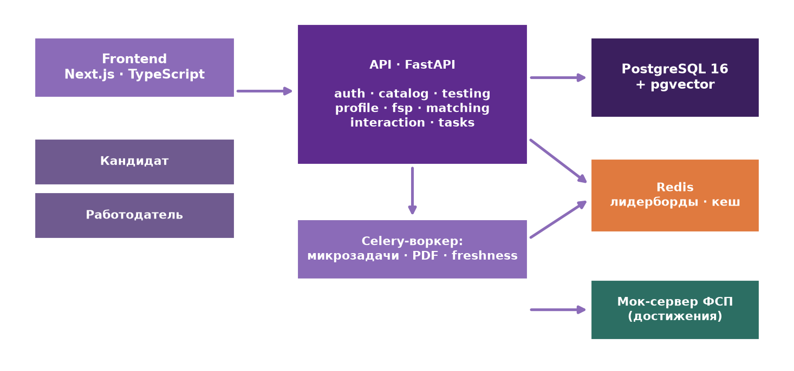
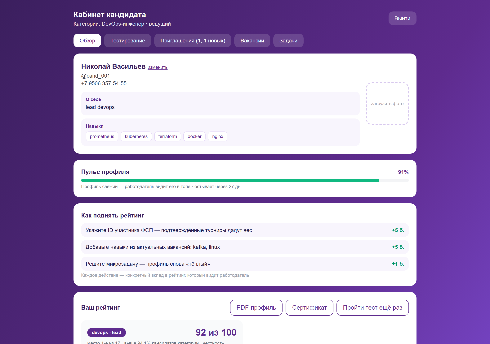
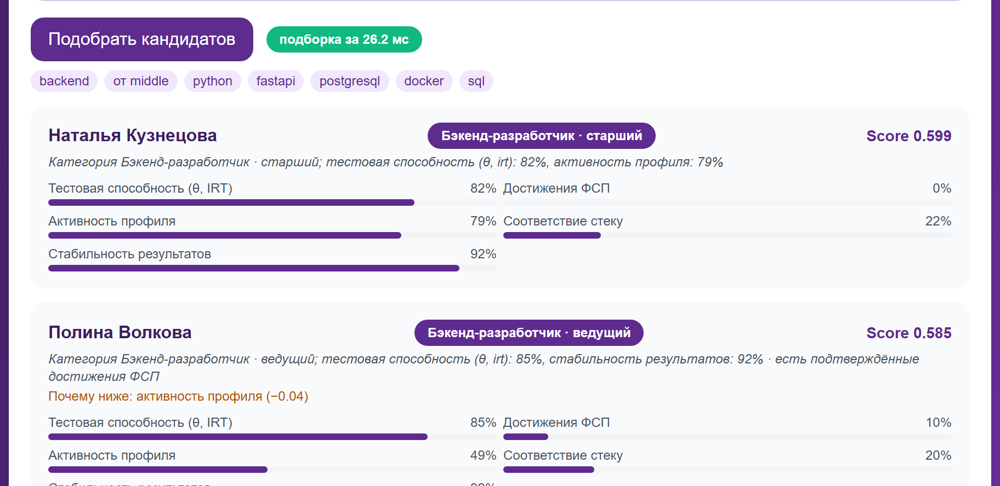
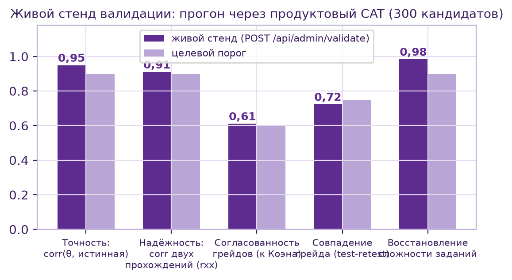
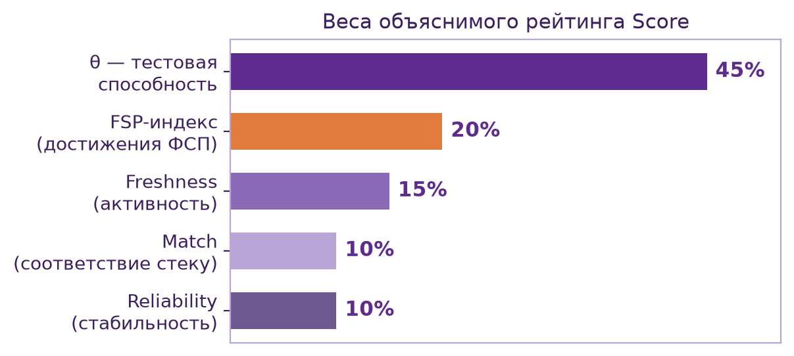

# Платформа подбора ИТ-специалистов с верифицированным профилем ФСП

Спецтрек ФСП на ЛЦТ 2026, команда Null Pointers.

Обратная механика подбора: кандидат один раз подтверждает грейд адаптивным
тестом и попадает в категорию, дальше работодатель описывает потребность,
получает объяснимую подборку и сам приглашает кандидата с вилкой зарплаты.
Контакты раскрываются только после принятия приглашения.



## Как это выглядит

| Кабинет кандидата | Подборка работодателя |
|---|---|
|  |  |

| Топ категории | Проверка сертификата по QR |
|---|---|
|  |  |

## Запуск

Одним файлом: **start.cmd** в корне (двойной клик). Сам поднимет Docker
Desktop, соберёт postgres + redis + api + frontend, дождётся отклика и откроет
браузер. Первый запуск фронта ставит зависимости внутри контейнера (2–5 минут),
дальше всё стартует за секунды.

```
start.cmd   запустить стенд
stop.cmd    остановить (контейнеры и данные сохраняются)
reset.cmd   сбросить демо-данные в состояние презентации
```

Вручную:
```bash
docker compose up -d --build
```
Стенд: http://localhost:3000 · Swagger: http://localhost:8000/api/docs

Демо-данные (150 кандидатов, 8 специализаций, 28 вакансий) сеятся
автоматически при пустой базе:
```bash
curl -X POST "http://localhost:8000/api/admin/seed?reset=true"
```

## Демо-аккаунты

| Роль | Логин | Пароль | Что посмотреть |
|---|---|---|---|
| Кандидат | demo_cand_001@example.ru | Candidate2026! | Николай Васильев, DevOps-инженер · ведущий, балл 92, топ-1 категории, сертификат с QR |
| Кандидат | demo_cand_002@example.ru | Candidate2026! | история попыток, пульс профиля |
| Работодатель | techlog@techlogistics.ru | Employer2026! | ТехноЛогистика: 4 вакансии, воронка 4/6/4/2, ответ кандидатов за ~47 часов, слепой найм |

## Что внутри

- Адаптивный CAT на IRT 3PL: EAP-оценка, остановка по SE ≤ 0.30, не больше 12
  заданий, контроль экспозиции, вариант задания уникален при каждой выдаче
- Детерминированный банк заданий, программирование на пяти языках; генератор
  тестов работодателя: поиск навыков в интернете, черновик, примеры с
  отмеченным верным ответом, публикация только после просмотра примеров
- Score с раскладкой по вкладам: 0.45 грейд + 0.20 ФСП + 0.15 активность +
  0.10 стек + 0.10 стабильность. Честность влияет только на стабильность,
  максимум на −0.04 балла; балл, грейд и место не меняются
- Античит: слишком быстрый ответ (3,5 с на тест, 12 с на код) и уход из окна
  дольше 8 секунд дают сигнал, каждый сигнал −15% к честности
- Подборка из 150 кандидатов за 25–48 мс (SLA 200 мс)
- bcrypt 12 раундов, JWT 60 минут + refresh 14 дней, rate limit 20/240
  запросов в минуту на ip через redis с локальным фолбэком
- Слепой найм, воронка с конверсией, живой лидерборд, демо-тест на лендинге
  без регистрации, PWA-манифест
- Реестр ФСП пока мок, контракт совместим с реальным; LLM оценки людей не
  выставляет

## Проверка точности

Симуляция 1500 кандидатов, два независимых прохождения, экспертная оценка
подборки (сырые данные в `docs/benchmark_*.json`):



| Метрика | Значение | Порог |
|---|---|---|
| corr(θ, истинная способность) | 0.955 | ≥ 0.90 |
| Надёжность rxx | 0.913 | ≥ 0.90 |
| Согласованность грейдов, κ Коэна | 0.606 (совпадение 72%) | ≥ 0.60 |
| Восстановление сложности заданий | 0.981 (57 из 60) | — |

Поиск по базе: P@10 = 0.45, MRR = 0.306, NDCG = 0.828 на 18 типовых запросах.
Прогон маленький, цифры не прячем.




## Тесты

36 сквозных проверок сценария (регистрация, CAT, сертификат, приглашения,
слепой найм, воронка) при запущенном стенде:
```bash
cd backend && python scripts/e2e_smoke.py
```

## Структура

```
backend/
  app/api/routes/      auth, профили, вакансии и отклики, тесты, лидерборд, seed
  app/core/            конфиг, JWT, bcrypt, rate limit на redis
  app/services/        объяснимый Score, PDF-сертификат с QR, валидация
  app/services/testing/  IRT 3PL, CAT, банк заданий, генератор тестов
  scripts/e2e_smoke.py   сквозная проверка (36 проверок)
frontend/              Next.js + Tailwind: лендинг, два кабинета, /verify
presentation/          колода из 18 слайдов и assets/ (графики, скриншоты)
docs/                  Документация.md и сырые результаты бенчмарков
docker-compose.yml     postgres (pgvector) · redis · api · frontend
```

## Документы

[Документация](docs/Документация.md) · [инструкция по установке](inst.txt) ·
презентация в `presentation/`

## Планы

Пуш-уведомления о приглашениях и LLM в конвейере проверки открытых ответов.
Оценку человека LLM не делает.
