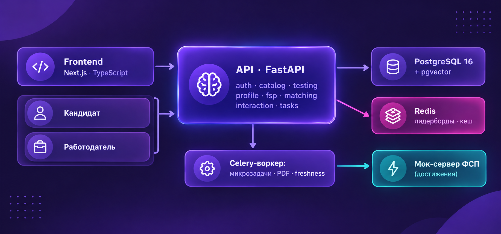
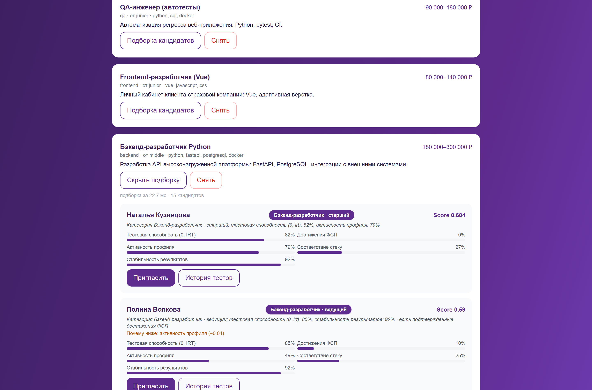
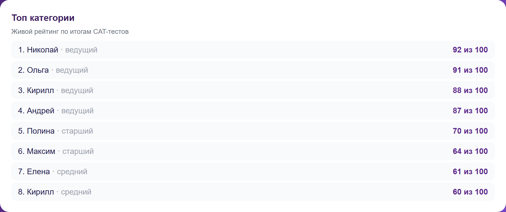
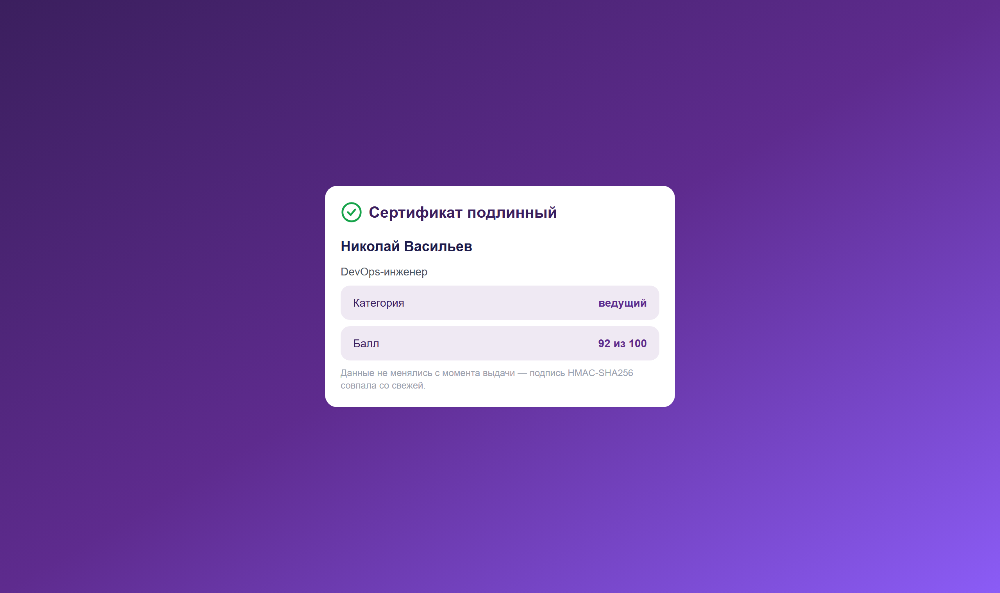
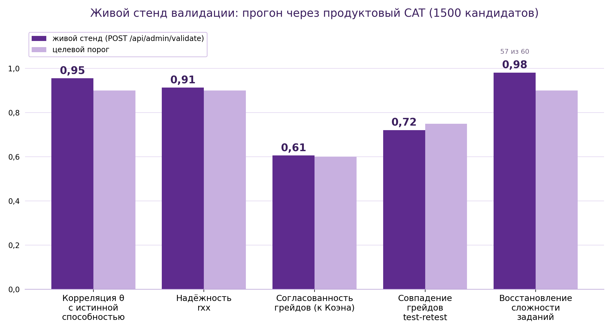
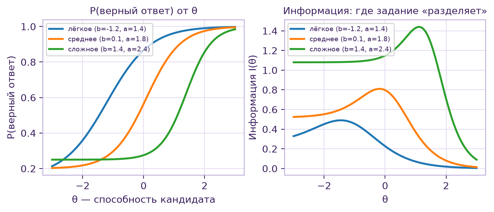
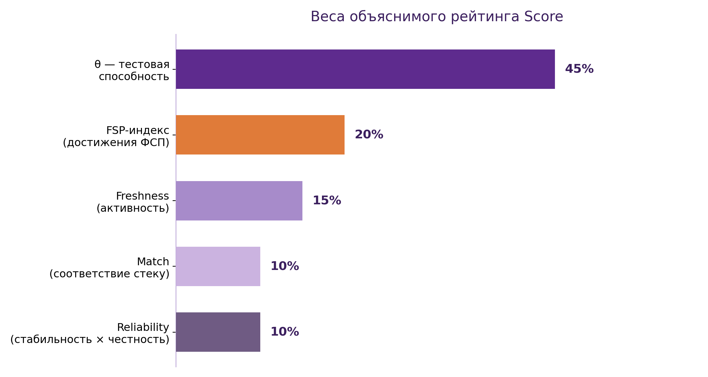

# Платформа подбора ИТ-специалистов с верифицированным профилем ФСП

Спецтрек ФСП на ЛЦТ 2026, команда Null Pointers.

Обратная механика подбора: кандидат один раз подтверждает грейд адаптивным
тестом и получает категорию (специализация × грейд) с подтверждёнными
достижениями ФСП. Работодатель описывает потребность текстом, получает
объяснимую подборку и сам приглашает кандидата с вилкой зарплаты. Контакты
раскрываются только после принятия приглашения или отклика — проверка на
сервере. Статусы взаимодействий (sent → viewed → accepted/declined) видны
обеим сторонам. Зарплата («от–до») обязательна и в вакансии, и в приглашении.
Регистрация по email с подтверждением. Кандидат без истории ФСП — валидный
сценарий, просто с нулевым вкладом достижений.



Модульный монолит: Next.js 14 + Tailwind, FastAPI + SQLAlchemy 2 (async),
PostgreSQL 16 + pgvector, Redis (лимитер и лидерборды). Модули backend —
auth, profiles (PDF-сертификат), testing (IRT/CAT, банк, конструктор
тестов, демо-квиз), matching (Score, подборка, слепой найм), interaction
(вакансии, приглашения, отклики, микрозадачи, воронка), leaderboard, fsp
(мок-реестр), admin (демо-данные).

## Как это выглядит

| Кабинет кандидата | Подборка работодателя |
|---|---|
|  |  |

| Топ категории | Проверка сертификата по QR |
|---|---|
|  |  |

## Запуск

Одним файлом: **start.cmd** в корне (двойной клик). Сам поднимет Docker
Desktop, соберёт postgres + redis + api + frontend, дождётся отклика и откроет
браузер. Первый запуск фронта ставит зависимости внутри контейнера (2–5 минут),
дальше всё стартует за секунды.

```
start.cmd   запустить стенд
stop.cmd    остановить (контейнеры и данные сохраняются)
reset.cmd   сбросить демо-данные в состояние презентации
```

Вручную: `docker compose up -d --build`. Стенд: http://localhost:3000 ,
Swagger: http://localhost:8000/api/docs , OpenAPI: /api/openapi.json —
все эндпоинты документированы там же. Фронт для разработки с hot reload:
`cd frontend && npm install && npm run dev`. Требования: обычная машина,
~2 ГБ RAM для контейнеров.

Демо-данные (150 кандидатов, 8 специализаций, 38 вакансий) сеятся
автоматически при пустой базе; полный сброс и пересид:

```bash
curl -X POST "http://localhost:8000/api/admin/seed?reset=true"
```

Сид детерминированный (seed=2026): кабинеты не выглядят пустыми — отклики,
приглашения, воронка, живая активность.

## Демо-аккаунты

| Роль | Логин | Пароль | Что посмотреть |
|---|---|---|---|
| Кандидат | demo_cand_001@example.ru | Candidate2026! | Николай Васильев, DevOps-инженер · ведущий, балл 92, топ-1 категории, сертификат с QR; в истории попыток сессия с честностью 70% — балл 12 из возможных 90 |
| Кандидат | demo_cand_002@example.ru | Candidate2026! | пульс профиля, микрозадачи, отклик на вакансию |
| Работодатель | techlog@techlogistics.ru | Employer2026! | ТехноЛогистика: 4 вакансии, воронка 4/6/4/2, ответ кандидатов за ~47 часов, слепой найм |

Демонстрационные ID реестра ФСП: FSP-2026-0001…0003 (есть история),
FSP-9999-999 (истории нет).

## Тестирование

**Психометрика (IRT 3PL).** Каждое задание банка имеет калиброванные
параметры: a — дискриминативность, b — сложность, c — поправка на
угадывание. Способность θ считается методом EAP (prior N(0,2)) и инвариантна
к набору заданий: кандидаты, отвечавшие разные варианты, сравнимы между
собой. Это решает дилемму ТЗ: единый банк запрещён (утечка), свободная
генерация несопоставима.

**Адаптивность (CAT).** Старт с заявленного грейда; после каждого ответа θ
пересчитывается, следующее задание — по максимуму информационной функции
I(θ); остановка при SE(θ) ≤ 0.30 или на 12 заданиях. Точный грейд за
10–15 вопросов. Пороги: < −0.5 junior, < 0.5 middle, < 1.5 senior, далее
lead. Повышение грейда не чаще раза в 90 дней, понижение всегда открыто.
Попытки не ограничены — подтверждается лучший результат категории.

**Устойчивость к утечкам.** Тело задания генерируется из параметризованного
шаблона с случайными данными при каждой выдаче — «слитый» ответ следующему
кандидату не помогает. Варианты перемешиваются, в сессии задания не
повторяются. После 50 показов задание деактивируется (контроль экспозиции).
Пополнение банка через LLM-конвейер — черновик → эталонное решение →
пилотная калибровка → банк; LLM оценки людей не выставляет.

**Честность.** Фиксируется время на каждый вопрос: верный ответ быстрее
порога (3,5 с выбор, 12 с свободный) = сигнал; уход со вкладки дольше 8 с
(Page Visibility API) с последующим верным ответом = сигнал, тест после
ухода начинается заново. Каждый сигнал −15% к показателю честности сессии.
Балл теста складывается из 100 очков: **90 за задания (по θ) + 10 за
честность** — при честности 80% потолок 98, при 50% — 95, при нуле — 90.
Грейд считается по θ и честность его не меняет; порядок в категории и
лидерборде — по баллу, поэтому честный результат стоит выше списанного
при равных знаниях; в рейтинге подбора честность дополнительно режет вклад
«стабильности» множителем (0.6 + 0.4 × integrity), максимум −0.04 из 1.0.

**Сертификат.** Кандидат с категорией выгружает PDF
(`GET /api/candidate/certificate.pdf`): специализация, грейд, балл, QR.
QR ведёт на публичную страницу `GET /api/verify/{user_id}/{signature}` —
сервер заново считает HMAC-SHA256 от (версия, кандидат, специализация,
грейд, балл) и сверяет с подписью в URL. Правка категории в обход теста
определяется сразу. Ключ подписи — секрет сервера.

## Подбор

Категория присваивается только по результату тестирования, не по резюме;
кандидатов несколько категорий допустимо (по одной на направление).

```
Score = 0.45·σ(θ) + 0.20·FSP + 0.15·Freshness + 0.10·Match + 0.10·Reliability
```

σ(θ) — тестовая способность; FSP — достижения ФСП (вес уровня × затухание
0.85^лет); Freshness — экспоненциальное затухание активности (период ~3
недели), поддерживается микрозадачами; Match — покрытие стека потребности
(MVP: пересечение тегов + семантическая близость; roadmap: pgvector);
Reliability — f(SE) и согласованность повторных прохождений, умноженная на
честность. Работодатель видит разложение вкладов и текстовое обоснование
каждого кандидата. NLP-парсинг потребности (MVP: правила + словарь стеков)
→ фильтр по категориям → ранжирование: 25–48 мс на 150 кандидатах (SLA 200).

Топ-10 категории живёт в Redis (ZSET), обновляется по завершении CAT и
отдаётся через `GET /api/leaderboard/{spec}` — рейтинг виден работодателю,
кандидатам топ не показываем, чтобы не сбивал фокус перед тестом. Слепой
наём (тумблер в кабинете работодателя): имена → «Кандидат №XXXX», фото
скрыты — решение по категории, стеку и честности. Воронка найма: вакансии →
отклики → приглашения → принято, конверсия и среднее время ответа.

## Тесты работодателя

Автопоиск навыков по описанию вакансии (DuckDuckGo, фолбэк — база знаний),
черновик собирается из банка с равномерным покрытием шкалы сложности.
Клик по вопросу открывает живой образец задания с отмеченным верным ответом
— детерминированный, один и тот же при каждой загрузке. Работодатель
оставляет или удаляет вопросы и добавляет свои: достаточно текста и верного
ответа — три неправильных варианта генерируются из словаря специальности
(числа и годы — вариациями вокруг ответа). Опубликованный тест прикрепляется
к приглашению, кандидат тестируется по нему.

## Реестр ФСП

Контракт спроектирован командой (API ФСП в хакатоне не предоставляются),
сейчас — мок, совместимый с реальным:

```
Кандидат → POST /api/fsp/link/{fsp_id}
Платформа → Реестр ФСП: GET /registry/{fsp_id}
Реестр → подписанная запись достижений (HMAC-SHA256)
Дальше: verifiable credentials + OIDC (Keycloak ФСП ID)
```

Запись: kind (tournament/olympiad/event), title, level, result, year.
Вес вклада калибруется совместно с ФСП после хакатона.

## Безопасность

PII (ФИО, контакты, summary) шифруются на уровне приложения: AES-256-GCM,
ключ HKDF из секрет-ключа, AAD-привязка к (таблица, поле); email — открытый
идентификатор входа (roadmap: слепой индекс). Пароли bcrypt 12 раундов
(~210 мс/проверка). JWT HS256 (roadmap RS256/OIDC под Keycloak), роль
проверяется в каждом запросе. Rate limit — скользящее окно в Redis (auth
20/мин, остальное 240/мин с IP → 429), при недоступности Redis деградация
в локальный буфер. 152-ФЗ: согласие на обработку (без него кандидат не
попадает в подборку), приватность профиля, контакты — только после принятия.

## Проверка точности

Симуляция 1500 кандидатов, два независимых прохождения, экспертная оценка
подборки (сырые данные в `docs/benchmark_*.json`):

| Метрика | Значение | Порог |
|---|---|---|
| corr(θ, истинная способность) | 0.955 | ≥ 0.90 |
| Надёжность rxx (test-retest) | 0.913 | ≥ 0.90 |
| Согласованность грейдов, κ Коэна | 0.606 (совпадение 72%) | ≥ 0.60 |
| Восстановление сложности заданий | 0.981 (57 из 60) | — |
| Скорость подборки, 150 кандидатов | 25–48 мс | < 200 мс |
| Подбор «вакансия → кандидат» P@10 / MRR / nDCG | 0.450 / 0.306 / 0.828 | 18 запросов |

Прогон по базе маленький, цифры не прячем.







В ходе валидации найдены и исправлены дефекты: формула информации 3PL
(была 2PL), MLE → EAP (стабильность начала теста), бесконечный цикл
генератора вариантов, калибровка порогов на наблюдаемой шкале.

## Сквозной тест

36 проверок сценария при запущенном стенде (регистрация → CAT → категория →
ФСП → подборка → свой тест → приглашение → принятие → раскрытие контактов →
отклики; демо-квиз, лидерборд, PDF-сертификат, отклонение поддельной
подписи, слепой найм, воронка):

```bash
cd backend && python scripts/e2e_smoke.py
```

## Стек

fastapi 0.143, uvicorn, sqlalchemy 2 (async), asyncpg, alembic, pydantic 2,
redis, pyjwt, bcrypt, numpy, httpx, cryptography, reportlab, segno;
frontend: next 14.2, react 18, typescript 5, tailwindcss 3.4.
PostgreSQL 16 + pgvector, Redis 7 — docker compose.

## Структура

```
backend/
  app/api/routes/      auth, профили, вакансии и отклики, тесты, лидерборд, seed
  app/core/            конфиг, JWT, bcrypt, AES-GCM, rate limit на redis
  app/services/        объяснимый Score, PDF-сертификат с QR, валидация
  app/services/testing/  IRT 3PL, CAT, банк заданий, генератор тестов
  scripts/e2e_smoke.py   сквозная проверка (36 проверок)
frontend/              Next.js + Tailwind: лендинг, два кабинета, /verify
png/                   скриншоты и иллюстрации для репозитория
docs/                  сырые результаты бенчмарков (benchmark_*.json)
docker-compose.yml     postgres (pgvector) · redis · api · frontend
inst.txt               пошаговая инструкция по файлам и запуску
```

## Планы

Пуш-уведомления о приглашениях и LLM в конвейере проверки открытых ответов.
Оценку человека LLM не делает.
