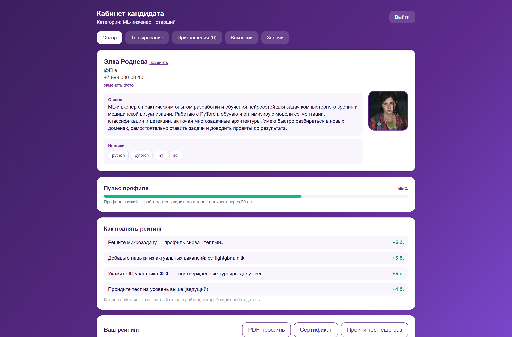

# Платформа подбора ИТ-специалистов с верифицированным профилем ФСП

Обратная механика подбора: кандидат один раз подтверждает грейд адаптивным
тестом и получает категорию с подтверждёнными
достижениями ФСП. Работодатель описывает потребность текстом, получает
объяснимую подборку и сам приглашает кандидата с вилкой зарплаты. Контакты
раскрываются только после принятия приглашения или отклика — проверка на
сервере. Статусы взаимодействий (sent → viewed → accepted/declined) видны
обеим сторонам.Регистрация по email с подтверждением.


Единое приложение.Интерфейс на Next.js 14 с Tailwind, сервер на FastAPI с SQLAlchemy 2, данные в PostgreSQL 16, лимитер и лидерборды в Redis. Логику разложили по модулям: auth (вход и регистрация), profiles (карточки и PDF с QR), testing (адаптивный тест IRT/CAT, банк, конструктор, демо-квиз), matching (Score, подборка, слепой найм), interaction (вакансии, приглашения, отклики, микрозадачи, воронка), leaderboard (топ категории), fsp (реестр ФСП), admin (демо-данные).

##Стек

Сервер: fastapi 0.143, uvicorn, sqlalchemy 2, asyncpg, alembic, pydantic 2, redis, pyjwt, bcrypt, numpy, httpx, cryptography, reportlab, segno. Интерфейс: next 14.2, react 18, typescript 5, tailwindcss 3.4. Хранилища: PostgreSQL 16 и Redis 7 через docker compose.

## Как это выглядит


 

## Запуск

Одним файлом: **start.cmd** в корне (двойной клик). Сам поднимет Docker
Desktop, соберёт postgres + redis + api + frontend, дождётся отклика и откроет
браузер. Первый запуск фронта ставит зависимости внутри контейнера (2–5 минут),
дальше всё стартует за секунды.

```
start.cmd   запустить стенд
stop.cmd    остановить (контейнеры и данные сохраняются)
reset.cmd   сбросить базу-данных
```

## Вручную

```
docker compose up -d --build
Стенд: http://localhost:3000 
API  : http://localhost:8000/api/docs  
```
 Фронт для разработки с hot reload:
`cd frontend && npm install && npm run dev`.
 Требования: обычная машина,
~2 ГБ RAM для контейнеров.

Демо-данные (150 кандидатов, 8 специализаций, 38 вакансий) сеятся
автоматически при пустой базе; полный сброс и пересид:

```bash
curl -X POST "http://localhost:8000/api/admin/seed?reset=true"
```


## Демо-аккаунты

| Роль | Логин | Пароль | Что посмотреть |
|---|---|---|---|
| Кандидат | demo_cand_002@example.ru | Candidate2026! | Мария Павлова, QA-инженер · джун: балл 19 из 100, пульс профиля, отправленный отклик на вакансию |
| Кандидат | demo_cand_047@example.ru | Candidate2026! | Дмитрий Зайцев, бэкенд-разработчик · джун: «32 из 100», место 17-е из 20, выше 15% категории |
| Кандидат | demo_cand_001@example.ru | Candidate2026! | Николай Васильев, DevOps-инженер · ведущий, балл 92, топ-1 категории, сертификат с QR |
| Кандидат | demo_cand_050@example.ru | Candidate2026! | Элка Роднева, ML-инженер · старший: фото, «о себе», Telegram @Elle |
| Работодатель | techlog@techlogistics.ru | Employer2026! | АйтиЛайт: 4 вакансии, логотип, воронка 4/6/4/2, ответ кандидатов за ~47 часов, слепой найм |
Демонстрационные ID реестра ФСП: FSP-2026-0001, FSP-2026-0002, FSP-2026-0003

## Тестирование

**Психометрика (IRT 3PL).** Каждое задание банка описывается тремя числами:
насколько хорошо оно отделяет сильных кандидатов от слабых, насколько оно
сложное и сколько в нём можно угадать наугад. Способность кандидата (θ)
считается методом EAP, а не по числу верных ответов, и не зависит от того,
какие именно задания человеку попались: ответившие на разные варианты
остаются сравнимыми между собой. Так закрыта дилемма ТЗ: единый банк заданий
быстро утекает на рынок, а свободно сгенерированные задания несопоставимы
по сложности.
Симуляция 1500 кандидатов, два независимых прохождения, экспертная оценка
подборки (сырые данные в `docs/benchmark_*.json`):

| Метрика | Значение | Порог |
|---|---|---|
| corr(θ, истинная способность) | 0.955 | ≥ 0.90 |
| Надёжность rxx (test-retest) | 0.913 | ≥ 0.90 |
| Согласованность грейдов, κ Коэна | 0.606 (совпадение 72%) | ≥ 0.60 |
| Восстановление сложности заданий | 0.981 (57 из 60) | — |
| Скорость подборки, 150 кандидатов | 19–28 мс | < 200 мс |
| Подбор «вакансия → кандидат» P@10 / MRR / nDCG | 0.444 / 0.272 / 0.778 | 18 запросов |


**Адаптивность (CAT).** 
Тест начинается с заданий для выбраного грейда, который выбрал кандидат. 
После каждого ответа система уточняет оценку уровня человека и даёт следующее задание перестраивая уровень на ходу
Границы грейдов проходят по значениям θ: ниже −0,5 — junior, до 0,5 — middle, до 1,5 — senior, выше — lead. 
Пересдавать можно сколько угодно раз: кандидату подтверждается лучший результат по категории, 
так что испортить себе тест неудачной попыткой невозможно.

**Устойчивость к утечкам.** Тело задания генерируется из параметризованного
шаблона с случайными данными при каждой выдаче — «слитый» ответ следующему
кандидату не помогает. Варианты перемешиваются, в сессии задания не
повторяются. После 50 показов задание деактивируется (контроль экспозиции).
Пополнение банка через LLM-конвейер — черновик → эталонное решение →
пилотная калибровка → банк; LLM оценки людей не выставляет.

**Честность.** Фиксируется время на каждый вопрос,если верный ответ быстрее
порога в 3,5 секунд ,то ставится −15%. Уход со вкладки теста до завершения 
обнуляет тест , все вопросы перемещиваются сначала не повторясь.
**Балл теста** складывается из 100 очков: **60 за задания, 10 за
честность 
Грейд считается по θ и честность его не меняет; порядок в категории и
лидерборде — по баллу, поэтому честный результат стоит выше списанного
при равных знаниях; в рейтинге подбора честность — самостоятельные 10%
веса Score.

**Сертификат.** Кандидат с категорией выгружает PDF с специализацей, грейдом, 
баллом, QR кодом.
QR ведёт на публичную страницу , где сервер заново считает HMAC-SHA256 и сверяет
с подписью в URL. Правка категории в обход теста определяется сразу.

## Подбор

Категория присваивается только по результату тестирования, не по резюме;
кандидатов несколько категорий допустимо (по одной на направление).

```
Score = 0.60· Тест + 0.20· ФСП + 0.10· Честность + 0.10· Активность
```


## Тесты работодателя
Работодатель описывает потребность в специалисте, система сама определяет
важные для роли навыки: сначала по открытым источникам (поисковая система DuckDuckGo), 
если ничего не нашлось, то используется информация из накопленной базы знаний. По найденным навыкам собирается 
черновик теста: задания подбираются так, чтобы в наборе встречались и лёгкие, и средние, 
и сложные — шкала сложности покрыта равномерно.Нажав на задание, работодатель видит, 
как оно будет выглядеть для кандидата, с отмеченным верным ответом.
Пример одинаковый при каждом открытии, поэтому задание можно спокойно 
оценить и принять решение.Предложенные задания можно оставить или убрать, также можно добавлять свои задания
отмечая верный ответ и перечисляя все не верные варианты ответов (от 3 до 20) которые будут автоматически перемещиваться.
Если пользователь укажет только текст и верный ответ, 
недостающие неправильные варианты система подставит сама по словарю специальности, 
числа и годы возьмёт правдоподобными рядом с верным ответом.


## Безопасность

Персональные данные (ФИО, контакты, рассказ о себе) шифруются на уровне приложения алгоритмом AES-256-GCM. Ключ шифрования получается из секретного ключа сервера (HKDF) и привязан к конкретной таблице и конкретному полю: данные из одной колонки нельзя расшифровать ключом от другой. Email остаётся открытым — по нему система узнаёт пользователя при входе; в планах перевести его на слепой индекс.
Пароли нигде не хранятся в виде текста: только хеши bcrypt в 12 раундов (примерно 210 миллисекунд на проверку), восстановить пароль из хеша невозможно.
Доступ к API защищён JWT-токенами (HS256), причём роль пользователя проверяется в каждом запросе, а не только при входе. В планах переход на RS256 и OIDC под Keycloak.
От подбора пароля и навалов на API защищает лимитер: скользящее окно в Redis пропускает 20 запросов в минуту на вход и 240 запросов в минуту с одного IP на всё остальное, свыше — отказ с кодом HTTP 429. Если Redis временно недоступен, лимитер продолжает считать запросы в локальном буфере памяти, так что защита не выключается вместе с кэшем.
Всё по 152-ФЗ: кандидат даёт согласие на обработку данных, и без него он просто не попадает в подборки работодателей. Приватность профиля настраивается самим кандидатом, а контакты открываются второй стороне только после принятия приглашения.


## Сквозной тест
Мы создали сценарий, при котором система автоматически проходит весь пользовательский путь: кандидат регистрируется, подтверждает почту, проходит тест, получает категорию и связывает ID ФСП, а работодатель описывает потребность, получает подборку, создаёт свой тест, отправляет приглашение с вилкой зарплаты, кандидат принимает его — и после этого открываются контакты. Отдельно проверяются демо-квиз, лидерборд, PDF-сертификат, отказ поддельного QR, слепой найм и воронка. Запустите прогон на своём стенде и увидите, что система работает целиком:
```
cd backend && python scripts/e2e_smoke.py

```


## Структура

```
backend/
  app/api/routes/      auth, профили, вакансии и отклики, тесты, лидерборд, seed
  app/core/            конфиг, JWT, bcrypt, AES-GCM, rate limit на redis
  app/services/        объяснимый Score, PDF-сертификат с QR, валидация
  app/services/testing/  IRT 3PL, CAT, банк заданий, генератор тестов
  scripts/e2e_smoke.py   сквозная проверка (36 проверок)
frontend/              Next.js + Tailwind: лендинг, два кабинета, /verify
tools/qr_check.html    офлайн-декодер QR-кода для демонстрации проверки
docs/                  сырые результаты бенчмарков (benchmark_*.json)
docker-compose.yml     postgres (pgvector) · redis · api · frontend
inst.txt               пошаговая инструкция по файлам и запуску
```

## Планы
Пуш-уведомления о приглашениях. Сейчас приглашение видно только когда зашёл в кабинет, а кандидат живёт в мессенджерах. Хотим присылать короткое уведомление о новом предложении — с названием компании, категорией и вилкой зарплаты, чтобы решение «интересно / неинтересно» занимало минуту и не требовало заходить на платформу.

Интеграция с настоящим реестром ФСП. Сейчас реестр — демонстрационная копия с придуманным командой контрактом. После хакатона планируем вместе с ФСП заменить её живым источником данных: верифицируемые учётные записи достижений и вход через Keycloak по ФСП ID. Наш контракт спроектирован так, чтобы такая замена не требовала переписывать половину системы.

Проверка открытых ответов с помощью LLM. В конструкторе тестов и в основном тестировании есть задания со свободным ответом. Модель может сравнить ответ кандидата с эталонным решением и подготовить черновик оценки с объяснением расхождений. Окончательный балл при этом выставляет человек: работодатель смотрит черновик и решает сам. Автоматическую оценку людей нейросетью не делаем и делать не будем — это принципиальная позиция.

Защита от фиктивных вакансий. Проверка компании-работодателя: подтверждение доменной почты компании, история публикаций, жалобы кандидатов, репортинг. Пока работодатель не прошёл проверку, его приглашения не уходят кандидатам.

Выгрузка в ATS-системы работодателей. Чтобы HR не переносил подборку руками в свою систему, выгрузка принятых кандидатов по стандартному формату.

Мобильная версия. Адаптивная вёрстка кабинетов: кандидату чаще всего нужно ровно одно действие — посмотреть приглашение и принять или отклонить его с телефона.
